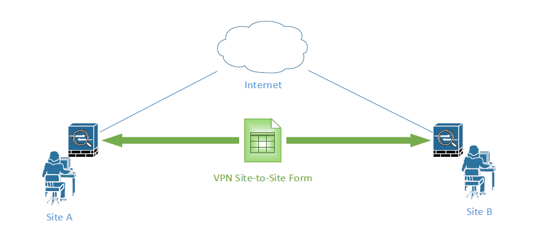
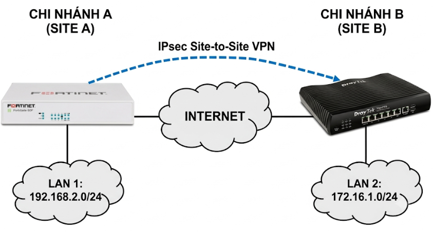
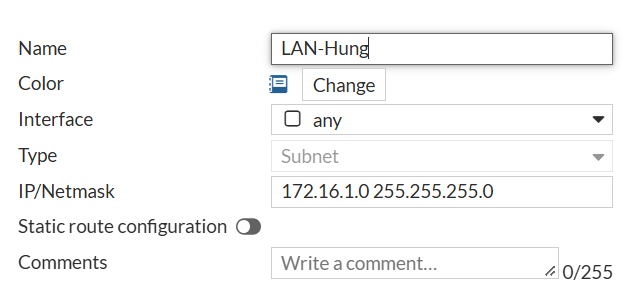
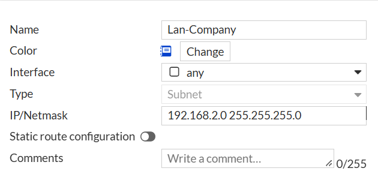
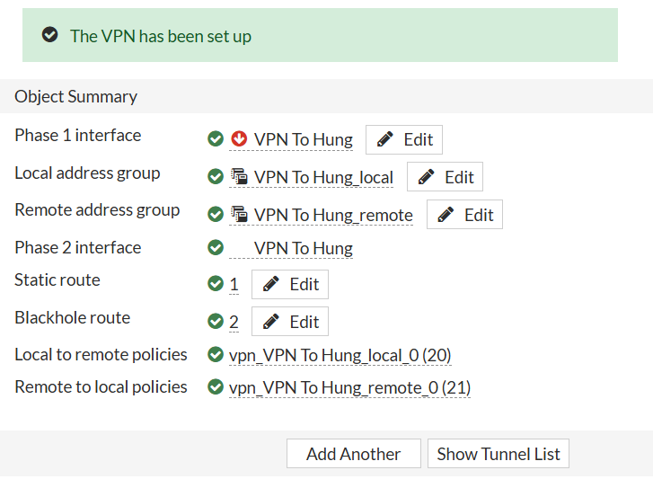
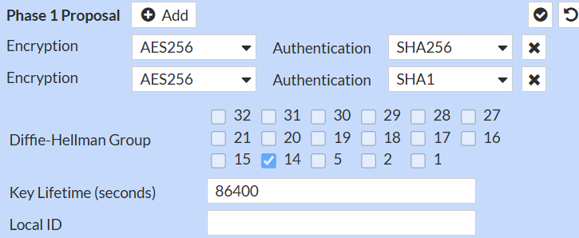
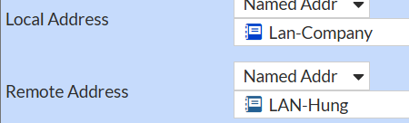
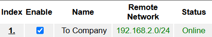

>**Lưu ý.** Thiết bị sử trong bài lab là Fortigate 80F và Draytek 2926, nếu không có thiết bị thật, hoàn toàn có thể thay thế bằng image ảo trong EVE/GNS3 .

## Mục tiêu

Cấu hình Site To Site để hai LAN giữa hai site có thể giao tiếp được với nhau.



## Môi trường

| Tài nguyên | Giá trị |
|---|---|
| Thiết bị | FortiGate 80F<br>Draytek 2926 |
| LAN A | 192.168.2.0/24 |
| LAB B | 172.16.1.0/24|

## Sơ đồ



## Các bước thực hiện
**Bước 1: Tạo hai address là hai LAN của hai site (192.168.2.0/24 và 172.16.1.0/24)**

Vào mục Policy&Object => Addresses => Create New để tạo 2 LAN.



**Bước 2: Tạo Tunnel VPN IPsec**

Truy cập vào VPN => IPsec Tunnel => Create New => Ipsec Tunnel

| Tùy chọn | Giá trị |
|---|---|
| Name | Tên đường VPN |
| Template Type | Site to Site |
| NAT Configuration| No NAT |

Sau đó bấm Next, cấu hình các thông số như sau:

| Tùy chọn | Giá trị |
|---|---|
|Remote Device| IP Adress|
|Remote IP| IP wan đầu Draytek|
|Outgoing Interface| Port WAN Fortigate|
|Authentication Method |Preshared-key|
|Preshared key | Key hai đầu giống nhau|

Sau đó bấm Next, trong Policy Routing, điền các tham số sau

| Tùy chọn | Giá trị |
|---|---|
|Local interface| Interface LAN Fortigate|
|Local Subnet| Subnet LAN đầu Fortigate|
|Rempte Subnet| LAN đầu Draytek|

Sau đó bấm Next rồi Create


Sau đó bấm vào Show Tunnel List để xem Tunnel mình vừa tạo.

**Bước 3: Custom Tunnel VPN**
Trong phần Edit VPN Tunnel, bấm Convert To Custom Tunnel để convert Tunnel sang tùy chọn.

Phase 1 Proposal và Phase 2 cần phải khớp với Draytek đầu kia.


Ở Phase 2, mục Local Address và Remote Address chọn 2 địa chỉ mà ta đã tạo ở phần đầu.

Thuật toán mã hóa Phase 2 cũng phải trùng với đầu Draytek, sau đó bấm OK.

**Bước 4: Viết Policty**

Sau khi tạo xong tunnel, ta sẽ viết Policy chiều đi và về cho Fortigate.

Rule chiều đi 
| Tùy chọn | Giá trị |
|---|---|
| Incoming Int | Int LAN forti|
| Outgoing Int | Chọn tunnel VPN đã tạo|
| Source | Subnet Forti |
| Dest | Subnet Draytek |
| NAT | Tắt |
|Security Profile| AntiVirus <br> IPS |
| SSL Inspection | Certification Inspection |

Rule chiều về

| Tùy chọn | Giá trị |
|---|---|
| Incoming Int | Tunnel VPN|
| Outgoing Int | Int Lan Forti|
| Source | Subnet Draytek |
| Dest | Subnet Forti|
| NAT | Tắt |
|Security Profile| AntiVirus <br> IPS |
| SSL Inspection | Certification Inspection |

**Bước 5: Static Route**

Vào Network => Static Route => Create New

| Tùy chọn | Giá trị |
|---|---|
| Destination | Subnet Draytek|
| Interface  | Chọn tunnel VPN |

Sau đó bấm OK, kết thúc cấu hình trên Fortigate.


**Bước 6: Cấu hình trên đầu Draytek**

Truy cập mục LAN to LAN trong VPN and Remote Access, bấm index bất kì dể khởi tạo VPN mới.

Setup các tham số như sau:

| Tùy chọn | Giá trị |
|---|---|
| Profile Name | Tên Tunnel|
| Enable Profile  | Tích |
| Dial-Out Setting  | Ipsec Tunnel|
| Server IP | WAN Fortigatr |
| Call Direction | Dial-out | 
| Always on | Tích| 
| Preshared Key| Trùng với đầu Forti| 
| Ipsec secu Method| Tùy chỉnh cho trùng với phase1, phase2 Forti| 
| My wan IP| WAN đầu Draytek|
| Remote Gateway IP| WAN đầu Fortigate|
| Remote Network IP| LAN đầu Forti|
| Local Network Ip| LAN Draytek|

## Kiểm tra 
VPN đầu Draytek

VPN đầu Fortigate

Từ máy trong LAN Draytek ping tới LAN Fortigate

```
C:\Users\mhung>ping 192.168.2.254

Pinging 192.168.2.254 with 32 bytes of data:
Reply from 192.168.2.254: bytes=32 time=6ms TTL=254
Reply from 192.168.2.254: bytes=32 time=5ms TTL=254
Reply from 192.168.2.254: bytes=32 time=6ms TTL=254
Reply from 192.168.2.254: bytes=32 time=6ms TTL=254

Ping statistics for 192.168.2.254:
    Packets: Sent = 4, Received = 4, Lost = 0 (0% loss),
Approximate round trip times in milli-seconds:
    Minimum = 5ms, Maximum = 6ms, Average = 5ms
```
Từ LAN Forti ping được LAN Draytek
```
Forti-80F-FW # execute ping-options source 192.168.2.254

Forti-80F-FW # execute ping 172.16.1.1
PING 172.16.1.1 (172.16.1.1): 56 data bytes
64 bytes from 172.16.1.1: icmp_seq=0 ttl=255 time=4.2 ms
64 bytes from 172.16.1.1: icmp_seq=1 ttl=255 time=3.8 ms
64 bytes from 172.16.1.1: icmp_seq=2 ttl=255 time=4.0 ms
64 bytes from 172.16.1.1: icmp_seq=3 ttl=255 time=4.0 ms
64 bytes from 172.16.1.1: icmp_seq=4 ttl=255 time=3.7 ms

--- 172.16.1.1 ping statistics ---
5 packets transmitted, 5 packets received, 0% packet loss
round-trip min/avg/max = 3.7/3.9/4.2 ms
```
✅ Hai LAN ở hai đầu đã ping thông tới nhau, cấu hình S2S giữa Draytek và Fortinet đã hoàn tất.