>**Lưu ý.** Thiết bị sử trong bài lab là Image Fortigate 7.0.3, các phiên bản image khác thao tác tương tự.

## Mục tiêu
Cấu hình HA hai FW Fortigate để dự phòng khi 1 trong 2 FW gặp sự cố, đảm bảo dịch vụ không bị gián đoạn.

## Sơ đồ đấu nối
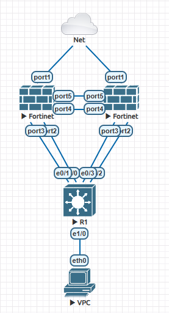
Để có thể cấu hình HA, hai FortiGate cần:
- Cùng model VM và phiên bản FortiOS tương thích, tốt nhất giống hệt nhau.
- Các interface có tên tương ứng: port1 đến port5.
- Có kết nối heartbeat trực tiếp như topology.
- HA group ID, group name và password giống nhau.
- Không cấu hình hai firewall độc lập cùng dùng IP 10.16.94.70 trước khi ghép HA.

## Cấu hình để truy cập giao diện GUI Fortigate

Vào CLI của Fortigate và cấu hình như sau
```
config system interface
    edit "port1"
        set mode static
        set ip 10.10.94.69 255.255.255.0
        set allowaccess ping https ssh
        set status up
    next
end
```
Cấu hình default route trên Fortigate
```
config router static
    edit 1
        set dst 0.0.0.0 0.0.0.0
        set gateway 10.16.94.1
        set device "port1"
    next
end
```
Từ một máy có thể truy cập tới dải 10.10.94.0/24, test ping tới IP wan của Fortigate
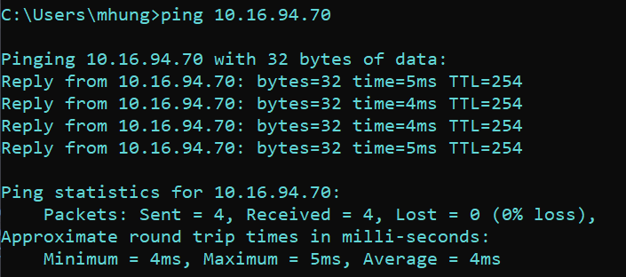

## Setup ban đầu và cấu hình LACP xuống Sw Core.
Chọn mục System => Setting => Đổi hostname 2 FW thành FGT-1, FGT-2.
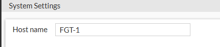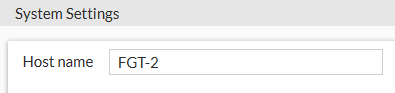

Tích vào mục Network => Interface => Create New để tạo LACP với 2 member là port2, port3.
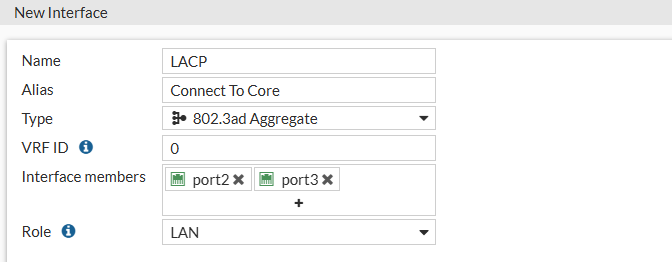
Tiếp tục cấu hình 2 VLAN trên FW và đưa chúng vào LACP, Create new => Interface 
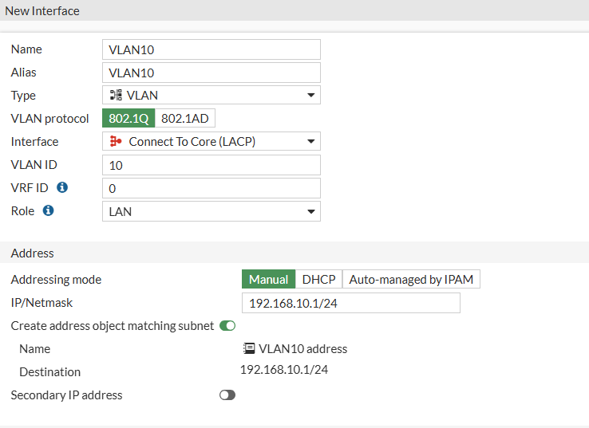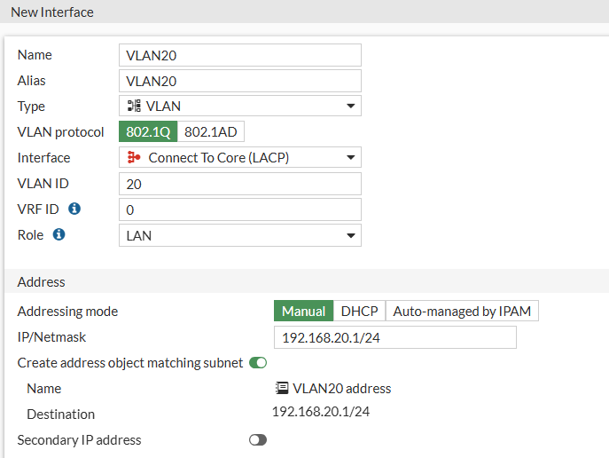 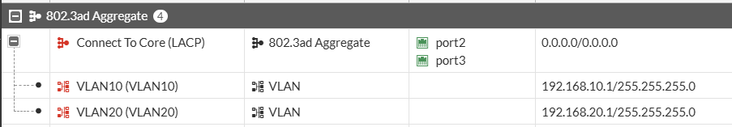
Tạo policy để 2 VLAN đi được ra INTERNET
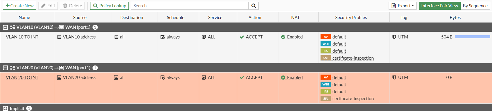
## Cấu hình HA hai Firewall Fortigate
Trên trình duyệt gõ https://10.16.94.70 để truy cập GUI, đối với FW còn lại, set 1 IP khác, ví dụ 10.16.94.71 cho cổng WAN để truy cập GUI, sau khi chúng HA, IP cổng WAN của FW passive sẽ được đồng bộ từ IP FW active.
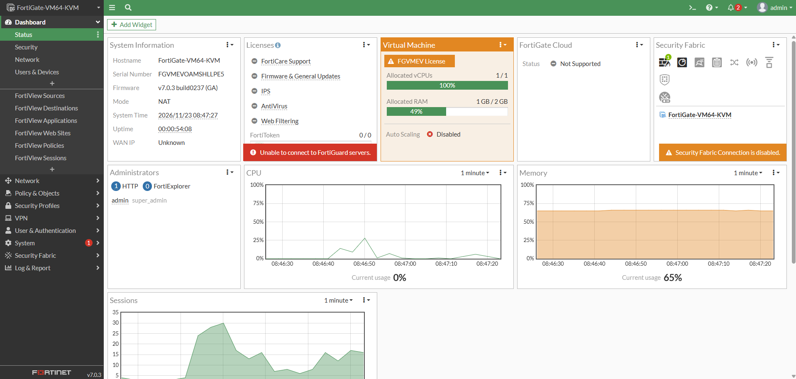

Trong mục system, chọn HA và chuyển sang mode active-passive
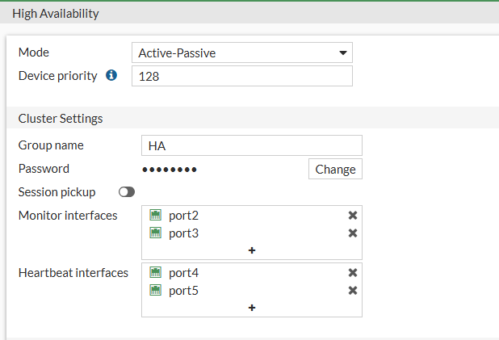

| Thông số| Giải thích|
|--|--|
| Device Priority| Cao hơn sẽ làm active|
| Group name| Hai FW phải cùng Group name|
| Password| Password HA phải giống nhau|
| Monitor Interface| Port giám sát failover|
| Heartbeat| Đồng bộ HA|

Sang FGT-2 truy cập System => HA và cấu hình tương tự, chỉ thay đổi priority thấp hơn FGT-1.

Sau đó GUI FGT-2 sẽ không thể load được nữa
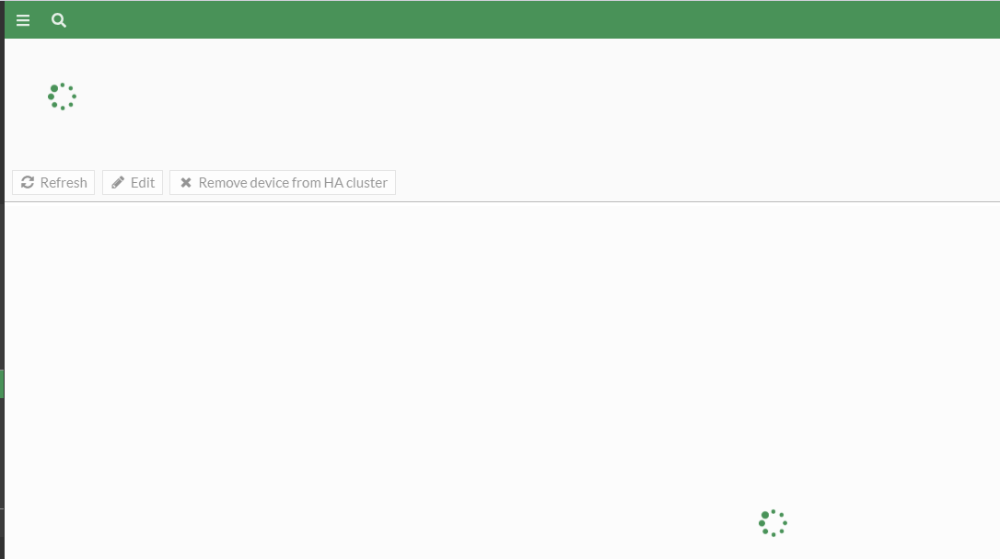
Chuyển qua FGT-1 vào HA để kiểm tra
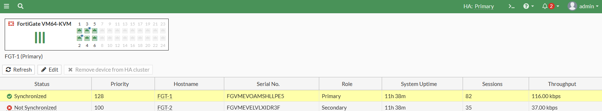
Dùng câu lệnh sau để ép đồng bộ HA nhanh trên cả 2 FW
```
execute ha synchronized start
```
Cả 2 FW đều hiện tích xanh như này là đồng bộ thành công
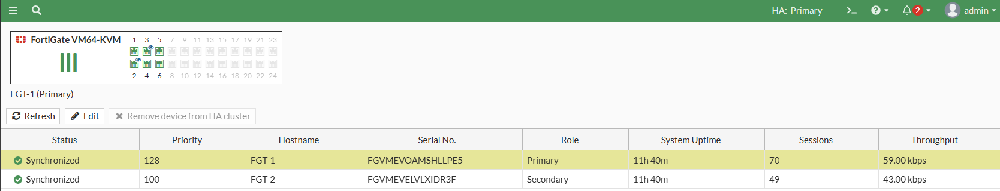
Dùng câu lệnh sau để xem chi tiết trạng thái HA
```
get system ha status
```
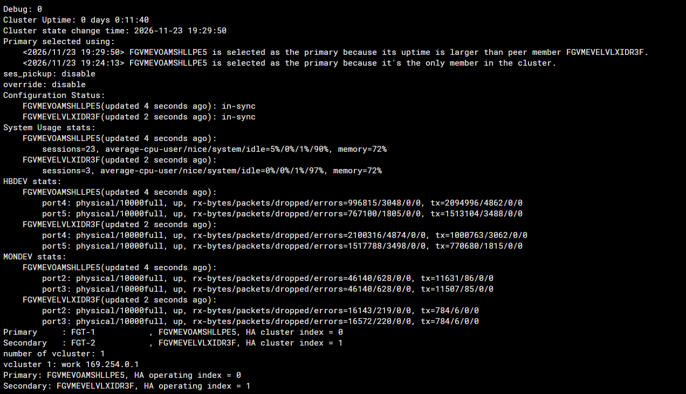
Để từ FW active muốn SSH vào CLI của FW passive ta làm như sau
```
execute ha manage <member-id> <username>
```
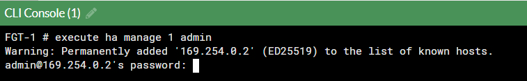
## Cấu hình LACP trên Sw-Core
Trên Sw-Core tạo 2 Port-channel lên 2 FW tương ứng
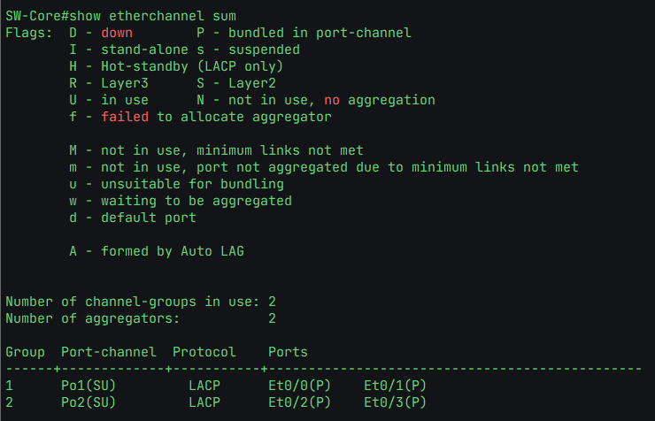
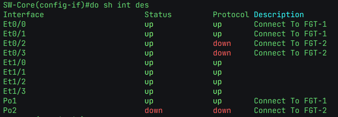
## Test HA
Từ VPC ping -t ra internet và shutdown FGT-1 chỉ thấy time out 2 gói.
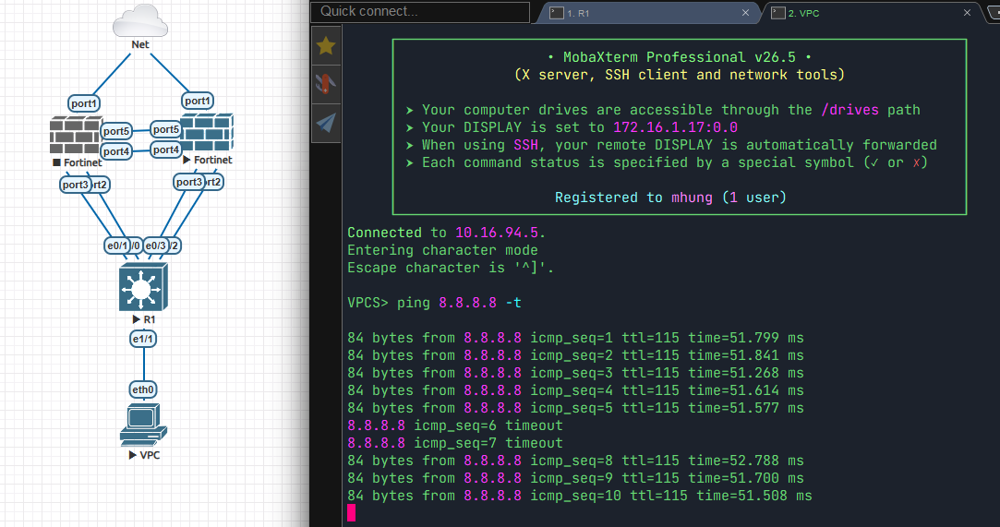
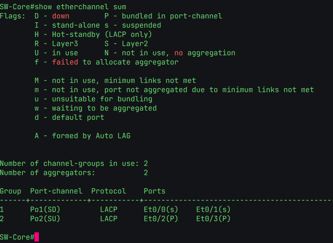
Bật FGT-1 lên và kiểm tra port-channel trên Sw-Core
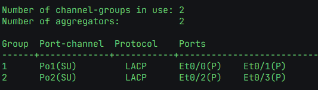
Đến đây ta đã hoàn tất cấu hình LACP trên cặp FW Fortinet để dự phòng, đảm bảo dịch vụ hoạt động ổn định khi 1 trong 2 FW gặp sự cố.