> **Lưu ý.** Bài lab này sử dụng image PAN 10.0, các phiên bản PAN khác làm tương tự.

## Mục tiêu
Cấu hình cho phép hai máy tính thuộc hai VLAN truy cập được Internet bên ngoài.
## Sơ đồ bài lab
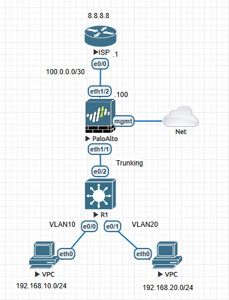
| Tài nguyên| Mô tả|
|--|--|
| Router Cisco| Mô phỏng ISP|
| Firewall | PAN 10.0|
| Core Switch| Chia VLAN|
| VPC| Máy trạm trong LAN|

## Thiết lập môi trường LAB
Truy cập vào giao diện EVE, đấu nối các thiết bị theo sơ đồ và khởi động toàn bộ tài nguyên.
## Cấu hình IP quản trị PAN, cho phép truy cập GUI
Tích chọn vào FW PAN và cấu hình cổng quản trị
```
configure
 # Cấu hình IP tĩnh
set deviceconfig system type static
set deviceconfig system ip-address 10.16.94.10
set deviceconfig system netmask 255.255.255.0
set deviceconfig system default-gateway 255.255.255.0
set deviceconfig system dns-setting servers primary 8.8.8.8

# Bật HTTPS, Ping, SSH
set deviceconfig system service disable-http no 
set deviceconfig system service disable-https no
set deviceconfig system service disable-icmp no
set deviceconfig system service disable-ssh no
commit # Confirm


```
Truy cập vào giao diện https://10.16.94.10 để vào giao diện FW.
## Cấu hình virtual router, Zones và Interface.
Virtual Router trên PAN được sử dụng để chia Router thành các router ảo, mỗi router có 1 bảng định tuyến riêng, chỉ các interface cùng 1 virtual router mới ping thông cho nhau. Ngoài default virtual router tạo mặc định, có thể tạo thêm virtual router mới.

Truy cập network => virtual router => add
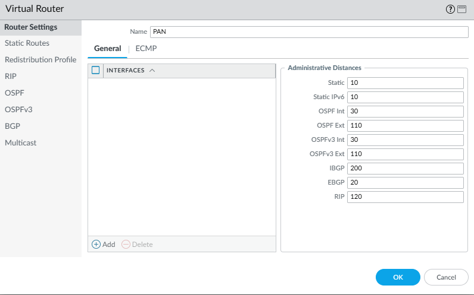
Tiếp theo cần set zones, zone được dùng nhóm các interface có chung security level, tạo trust cho LAN và Untrust cho WAN. Cùng zone mặc định permit, khác zone sẽ deny.

Truy cập **Network** => **Zones**, chọn **Add** và tạo 2 zone là trust, untrust, type là layer3.
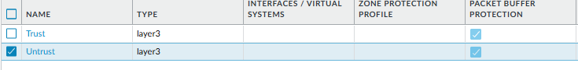
Cấu hình IP cho các Interface, truy cập **Network** => **Interface** => **Ethernet**, chọn interface eth1/2 (WAN)
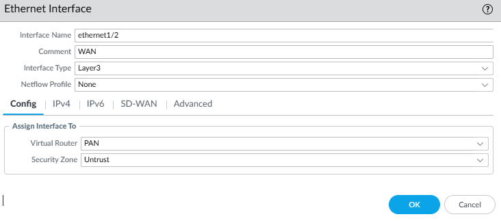
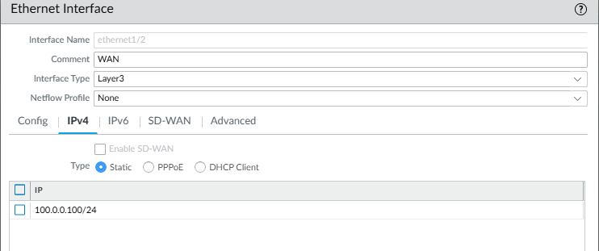

Cấu hình cổng Eth1/1 cho 2 VLAN 10 và 20. Cổng eth1/1 sẽ được cấu hình subinterface để làm gateway của 2 VLAN.
| Tùy chọn| Giá trị|
|--|--|
| Interface Type | Layer3|
| Virtual Router| PAN
| Security Zone| Trust
Chọn Add Subinterface id 10 cho cổng ethernet1/1
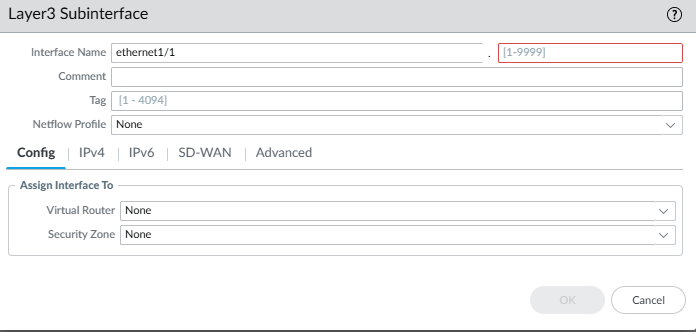

| Tùy chọn| Giá trị|
|--|--|
| Interface name | 10|
| Tag| 10
| Virtual Router| PAN
| Security Zone| Trust

Chuyển sang tab IPV4, set IP gw là 192.168.10.1/24, thực hiện tương tự cho subinterface 20 còn lại
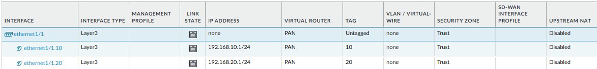

## Cấu hình default route
Truy cập **Network** => **Virtual Router** => **PAN**, trong mục Static Route cấu hình như sau
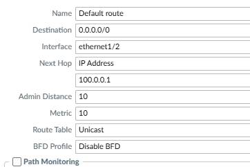
## Tạo các Object Addresses
Truy cập **Object** => **Addresses** => **Add**
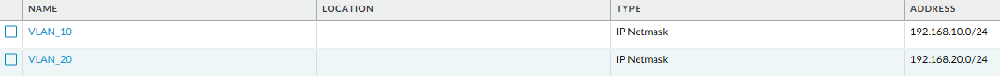
## Tạo NAT Rule
Tạo NAT overload để cho phép NAT giữa mạng nội bộ và IP WAN
Truy cập **Policies** => **NAT** => **Add**
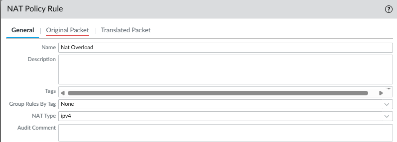
Chuyển qua tab Original Packet
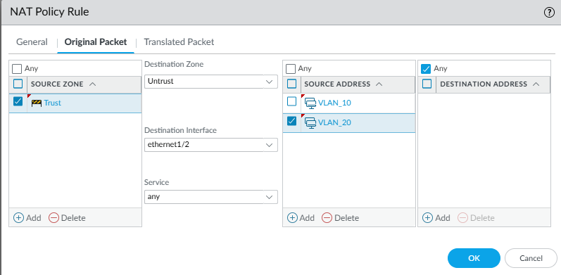
Chuyển qua tab Translate Packet
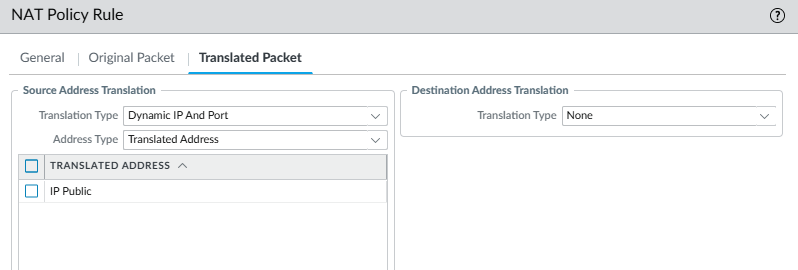 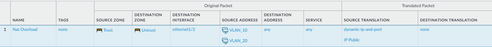
## Viết Policy cho truy cập Internet
Truy cập Policies > Security, chọn Add:
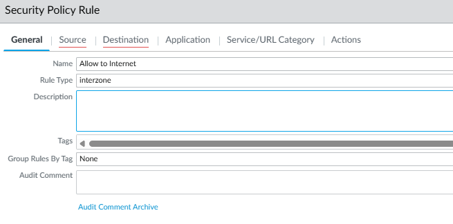 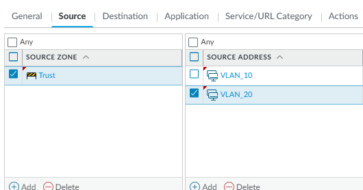 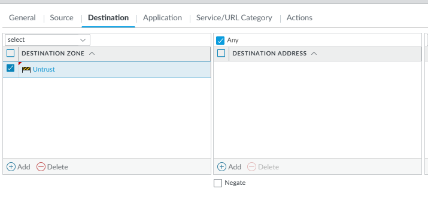 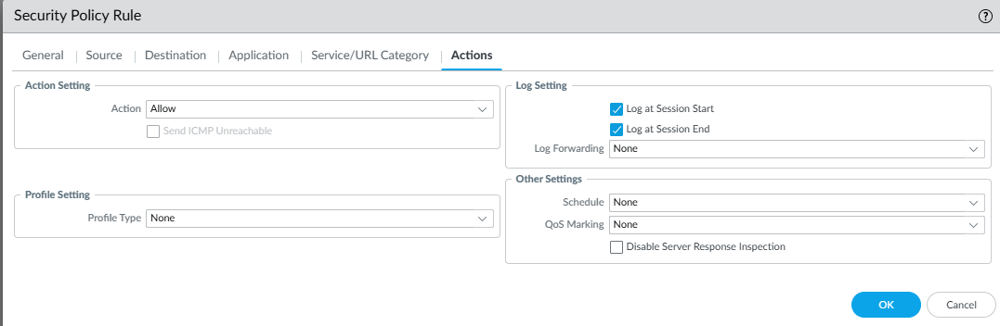

Bấm commit để áp dụng cấu hình

## Cấu hình trên Sw ISP, Sw Core
**Sw ISP**
```
conf t
int e0/0
no shut
ip address 100.0.0.1 255.255.255.0
int lo0
ip address 8.8.8.8 255.255.255.255
```
Kiểm tra interface trên Sw ISP
```
Router(config-if)#do sh ip int br
Interface                  IP-Address      OK? Method Status                Protocol
Ethernet0/0                100.0.0.1       YES manual up                    up
Ethernet0/1                unassigned      YES unset  administratively down down
Ethernet0/2                unassigned      YES unset  administratively down down
Ethernet0/3                unassigned      YES unset  administratively down down
Loopback0                  8.8.8.8         YES manual up                    up
```
**SW Core**
```
Switch#conf t
Enter configuration commands, one per line.  End with CNTL/Z.
Switch(config)#
Switch(config)#
*Nov 14 10:10:39.953: %PNP-6-PNP_DISCOVERY_STOPPED: PnP Discovery stopped (Config Wizard)
Switch(config)#vlan 10
Switch(config-vlan)#
Switch(config-vlan)#vlan 20
Switch(config-vlan)#
Switch(config-vlan)#int e0/0
Switch(config-if)#
Switch(config-if)#sw
Switch(config-if)#switchport access vlan 10
Switch(config-if)#
Switch(config-if)#int e0/1
Switch(config-if)#
Switch(config-if)#switchport access vlan 20
Switch(config-if)#int e0/2
Switch(config-if)#
Switch(config-if)#switchport trunk encapsulation dot1q
Switch(config-if)#
Switch(config-if)#switchport mode trunk
Switch(config-if)#do wr
Building configuration...
Compressed configuration from 857 bytes to 586 bytes[OK]
```
**VPC Vlan10**
```
VPCS> ip 192.168.10.100 255.255.255.0 192.168.10.1
Checking for duplicate address...
VPCS : 192.168.10.100 255.255.255.0 gateway 192.168.10.1
```
**VPC Vlan20**
```
VPCS> ip 192.168.20.100 255.255.255.0 192.168.20.1
Checking for duplicate address...
VPCS : 192.168.20.100 255.255.255.0 gateway 192.168.20.1
```
## Kiểm tra kết nối
Từ PC VLAN 10
```
VPCS> sh ip

NAME        : VPCS[1]
IP/MASK     : 192.168.10.100/24
GATEWAY     : 192.168.10.1
DNS         :
MAC         : 00:50:79:66:68:04
LPORT       : 20000
RHOST:PORT  : 127.0.0.1:30000
MTU         : 1500

VPCS> ping 8.8.8.8

84 bytes from 8.8.8.8 icmp_seq=1 ttl=254 time=1.462 ms
84 bytes from 8.8.8.8 icmp_seq=2 ttl=254 time=2.230 ms
84 bytes from 8.8.8.8 icmp_seq=3 ttl=254 time=1.920 ms
84 bytes from 8.8.8.8 icmp_seq=4 ttl=254 time=1.547 ms
```
Từ PC VLAN 20
```
VPCS> show ip

NAME        : VPCS[1]
IP/MASK     : 192.168.20.100/24
GATEWAY     : 192.168.20.1
DNS         :
MAC         : 00:50:79:66:68:05
LPORT       : 20000
RHOST:PORT  : 127.0.0.1:30000
MTU         : 1500

VPCS> ping 8.8.8.8

84 bytes from 8.8.8.8 icmp_seq=1 ttl=254 time=2.364 ms
84 bytes from 8.8.8.8 icmp_seq=2 ttl=254 time=2.004 ms
84 bytes from 8.8.8.8 icmp_seq=3 ttl=254 time=1.767 ms
84 bytes from 8.8.8.8 icmp_seq=4 ttl=254 time=1.736 ms
84 bytes from 8.8.8.8 icmp_seq=5 ttl=254 time=1.822 ms
```
