> **Lưu ý.** Bài lab này sử dụng image PAN 10.0, các phiên bản PAN khác làm tương tự.

## Mục tiêu
Cấu hình HA hai Firewall PAN sao cho 1 FW down thì dịch vụ đi Internet không bị down.
## Mô hình Lab
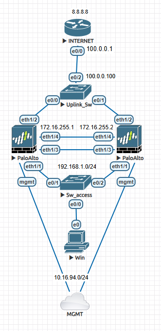
| Tài nguyên| Giá trị| 
|--|--|
| Firewall| 2 Image PAN|
| Switch | 2 Image Switch|
| PC | 1 Image win7|
| Router| 1 Image Router|
| LAN Subnet| 192.168.1.0/24|
| WAN Subnet| 100.0.0.0/24|
| HA subnet| 172.16.255.0/30|

## Cấu hình Router ISP
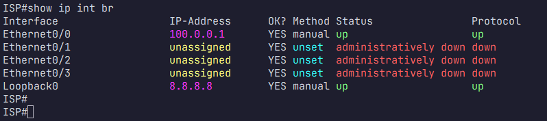
## Cấu hình MGMT cho hai FW
Trên FW PAN-1

```
configure
set deviceconfig system hostname PAN-1
set deviceconfig system type static
set deviceconfig system ip-address 10.16.94.101 netmask 255.255.255.0 default-address 10.16.94.1
set deviceconfig system service 

set deviceconfig system service disable-telnet yes
set deviceconfig system service disable-http no
set deviceconfig system service disable-https no

commit
```
Làm tương tự trên FW PAN-2
## Cấu hình HA Interface
Truy cập Network => Network => Ethernet => Chọn ethernet 1/3
| Trường| Giá trị|
|--|--|
| Interface| ethernet1/3|
| Interface Type| HA|
| Link State| Auto|

Sau đó nhấn OK, tiếp tục tích chọn Ethernet1/4

| Trường| Giá trị|
|--|--|
| Interface| ethernet1/4|
| Interface Type| HA|
| Link State| Auto|

Sau đó nhấn OK.

## Bật HA trên PAN-1
Vào Device => High Availability => General => Setup

| Trường| Giá trị|
|--|--|
| Enable HA| Bật|
| Group ID| 1|
| Mode| Active Passive|
| Enable Config Sync| Bật|
| Peer HA1 IP Address| 172.16.255.2|

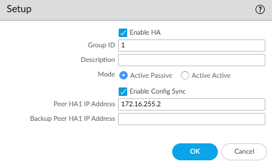

## Cấu hình HA-1 trên PAN-1
Vào Device => Hight Availability => HA Communications => Control Link (HA1)
| Trường| Giá trị|
|--|--|
| Port| ethernet1/3|
| IPv4 Address| 172.16.255.1|
| Netmask| 255.255.255.252|
| GW| Trống|

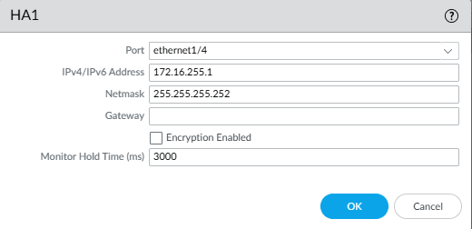

## Cấu hình HA2 trên PAN-1
Vào Device => High Availibility => HA Communication => Data Link (HA2)
| Trường| Giá trị PA1|
|--|--|
| Port| ethernet1/4|
| Transport| Ethernet|
| Enable Session Synchronization| Bật|
| HA2 Keep-alive| Bật, dùng Monitor cho lab|

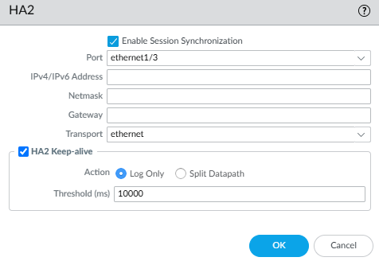

## Cấu hình Election Settings trên PAN-1
Vào Device → High Availability → General → Election Settings

| Trường| Giá trị|
|--|--|
| Device Priority| 100|
| Preemptive| Disable|
| Heartbeat Backup| Enable, nếu MGMT hai firewall liên lạc được|
| HA Timers| Recommended|

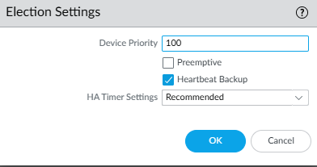

Sau đó vào Active/Passive Settings => Passive Link State: Auto.

Cuối cùng Commit trên FW PAN-1

## Cấu hình tương tự trên FW PAN-2
Trên PAN-2, thực hiện lại các mục tương tự nhưng đổi địa chỉ HA1 và Peer HA1.

Vào General => Setup
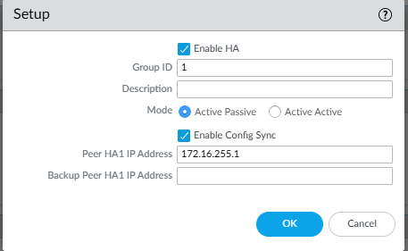
Ha Communications => HA1
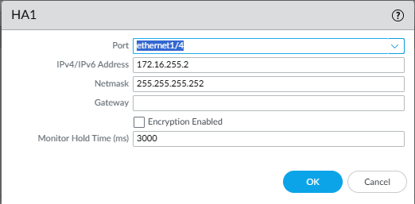
HA Communications → HA2
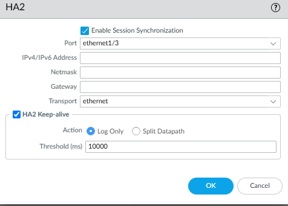

Trong mục Election Settings
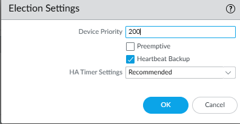

Sau đó Commit để lưu cấu hình PAN-2

## Kiểm tra cấu hình
Sau khi commit trên cả hai FW, chạy các lệnh sau trên hai FW để kiểm tra trạng thái HA
```
show high-availability state
show high-availability all
show high-availability interface ha1
show high-availability interface ha2
```
Các trạng thái cần xem
| Mục| Kết quả|
|--|--|
| HA Mode| Active-Passive|
| HA1| Up|
| HA2| Up|
| Peer Connection| Connected|
| Local State| Một active và một passive|
| Configuration Sync| Synchronized|

> **Lưu ý:** Khi HA được ghép cặp và bạn xác định đúng firewall là Active, ở đây là PAN 1 do Priority đang set là 100, thực hiện trên FW Active để đồng bộ cấu hình thủ công sang FW Passive nếu trạng thái Configuration Sync là Not synchronized.
```
request high-availability sync-to-remote running-config
```
Cuối cùng test dịch vụ khi 1 trong hai FW ngừng hoạt động, tiến hành ping -t từ VPC tới ISP và chạy lệnh sau trên FW active

```
request high-availability state suspend
```
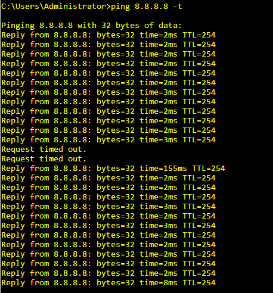

Sau khi test PAN-1 ngừng hoạt động thì PAN-2 đã lên tiếp quản traffic đảm bảo dịch vụ hoạt động ổn định.

Đưa PAN-1 hoạt động trở lại
```
request high-availability state functional
```
Lúc này FW PAN-1 sẽ trở thành passive còn PAN-2 sẽ làm active do tính năng preempt đang tắt.
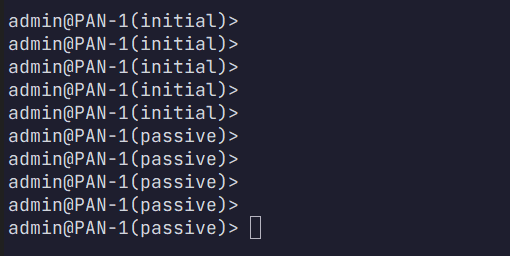 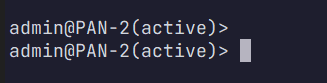

Đến đây chúng ta đã cấu hình hoàn chỉnh tính năng HA trên hai FW PAN để đảm bảo dịch vụ được duy trì 24/7 khi 1 trong 2 FW gặp sự cố về phần cứng.