> **Lưu ý.** Bài lab này sử dụng image PAN 10.0, các phiên bản PAN khác làm tương tự.
## Mục tiêu
Mở dịch vụ RDP(port 3389) ra ngoài Internet để máy Admin từ xa có thể RDP vào.
## Mô hình Lab
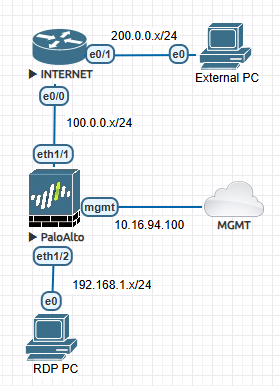
| Tài nguyên| Giá trị|
|--|--|
| Router| Image Cisco Router|
| Firewall| PAN OS v10|
| PC| 2 PC win7|
| LAN| 192.168.1.x/24|
| WAN| 100.0.0.x/24|
| WAN| 200.0.0.x/24|

## Chuẩn bị
Kéo các image vào EVE và khởi động toàn bộ tài nguyên LAB

## Setup giao diện FW PAN và cấu hình cơ bản
Xem hướng dẫn cấu hình mở GUI trên PAN ở đây [Hướng dẫn cấu hình PAN cơ bản](https://mhung03.github.io/firewall/palo-alto/cau-hinh-pan-co-ban/)
## Định nghĩa cho IP và Services
Trước hết ta cần tạo Object cho các Ip address cũng như service cần NAT để dễ dàng sử dụng. Vào menu Object => Address => Add.
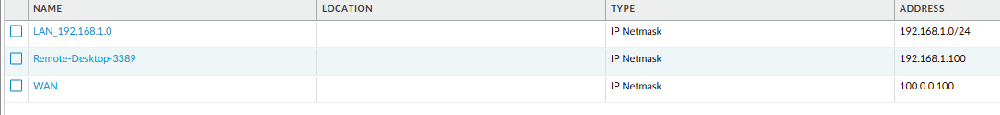
| Tên| Chi tiết|
|--|--|
| LAN_192.168.1.0| Subnet LAN|
| Remote-Desktop-3389| Máy RDP|
| WAN| IP WAN|

Vào mục Object => Service => Add để tạo service RDP
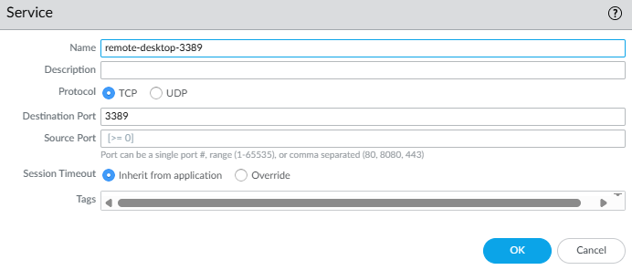
## Cấu hình NAT Rule
Trong mục Policies chọn mục NAT và Add rule như sau:
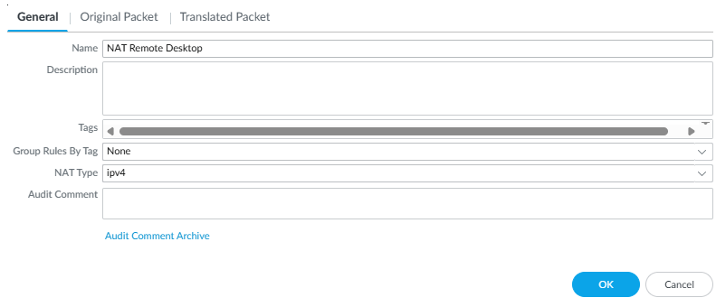
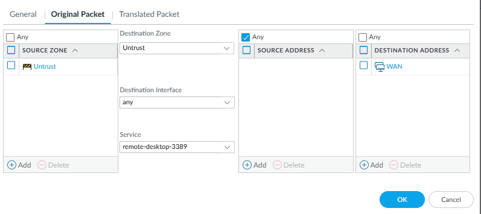

| Tên| Chi tiết|
|--|--|
| Source zone| Zone chứa cổng WAN|
| Destination zone| Zone chứa cổng WAN|
| Service| port 3389|
| Destination address| WAN-IP|

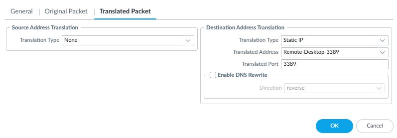

| Tên| Chi tiết|
|--|--|
| Translation type| Static IP|
| Translated address| Object PC RDP|
| Translated port| 3389|

## Viết Policy
Vào Policy => Security => Add
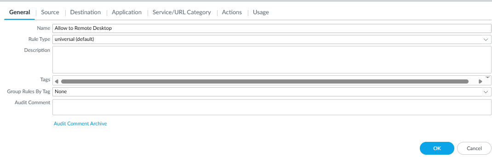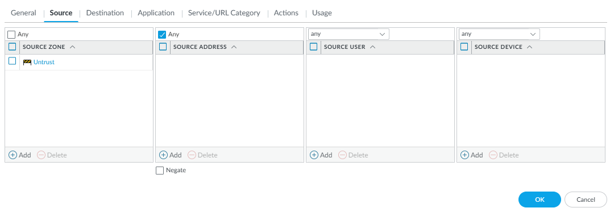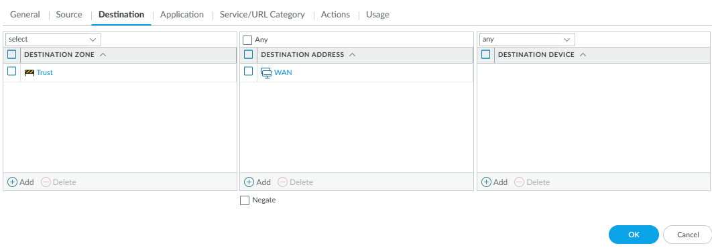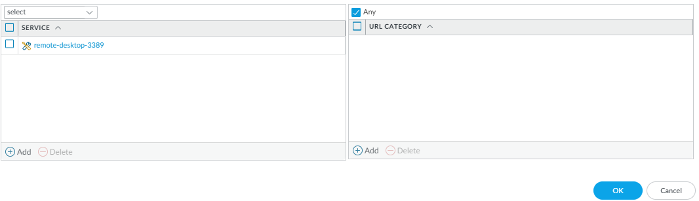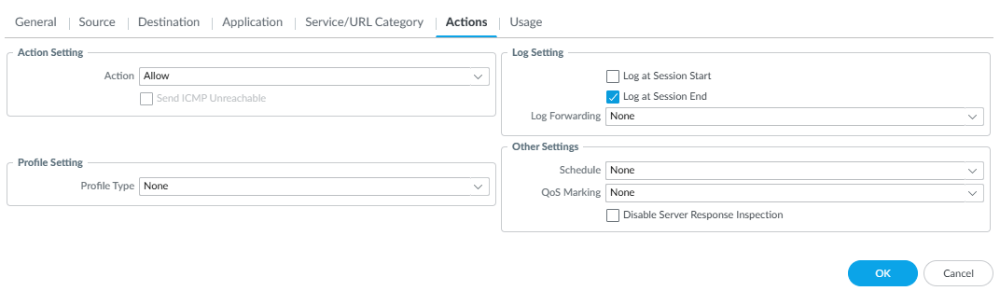

## Cấu hình Router Internet 
Set IP cho các Interface Router như sau
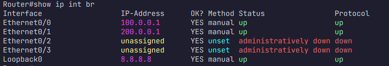

## Kiểm tra cấu hình
Trên máy PC ngoài Internet, RDP bằng IP WAN của FW
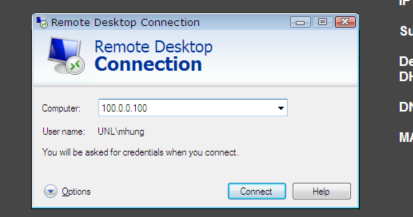 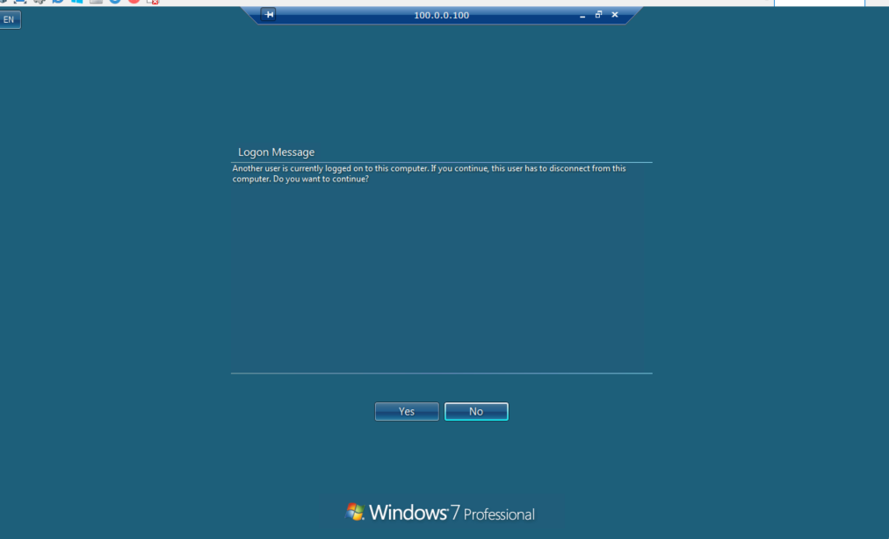
✅ PC ADMIN ngoài Internet đã RDP vào host nội bộ thành công.