> **Lưu ý.** Bài lab này sử dụng image PAN 10.0, các phiên bản PAN khác làm tương tự.

## Mục tiêu
Cấu hình trên Firewall PAN cho phép máy trong LAN truy cập được Internet.
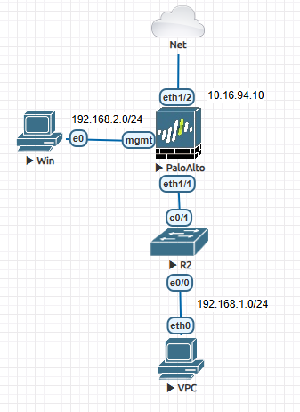


| Tài nguyên | Giá trị |
|--|--|
| Thiết bị| Palo-Alto 10.0|
| PC Admin| Image win7 |
| LAN| 192.168.1.0/24|
| WAN| 10.16.94.0/24|


## Các bước thực hiện

Truy cập vào console thiết bị và gõ các lệnh sau để có thể vào GUI trên trình duyệt.
```bash
configure
 # Cấu hình IP tĩnh
set deviceconfig system type static
set deviceconfig system ip-address 192.168.2.254
set deviceconfig system netmask 255.255.255.0
set deviceconfig system dns-setting servers primary 8.8.8.8

# Bật HTTPS, Ping, SSH
set deviceconfig system service disable-http no 
set deviceconfig system service disable-https no
set deviceconfig system service disable-icmp no
set deviceconfig system service disable-ssh no
commit # Confirm cấu hình
```
Hiển thị như này là commit thành công.
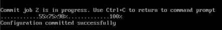
Set IP tĩnh máy PC cho trùng dải quản trị rồi test ping tới PAN
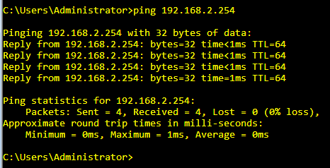


Kiểm tra truy cập giao diện GUI: https://192.168.2.254

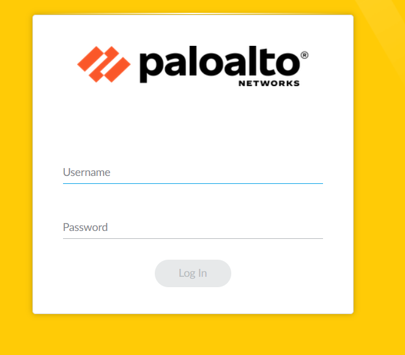

## Đặt IP cho các Interface
Trước tiên cần set IP cho các interface, truy cập vào Interface => Ethernet => ethernet1/1
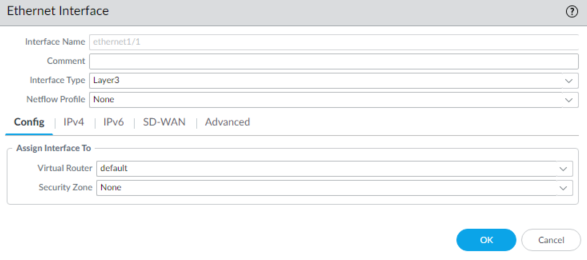
Chuyển sang tab IPv4 để set IP cho interface
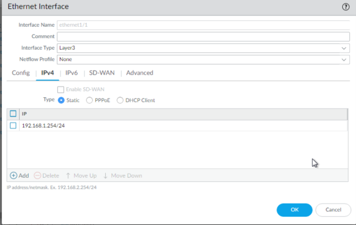
Sau đó bấm Ok để lưu, tương tự với cổng WAN ethernet 1/2
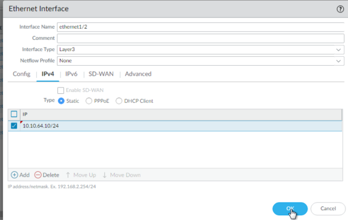
## Tạo zones trên Firewall
Tiếp theo cần tạo zones cho FW, cổng WAN sẽ là Untrust, LAN là Trust, tiến hành vào Network => Zones => Add
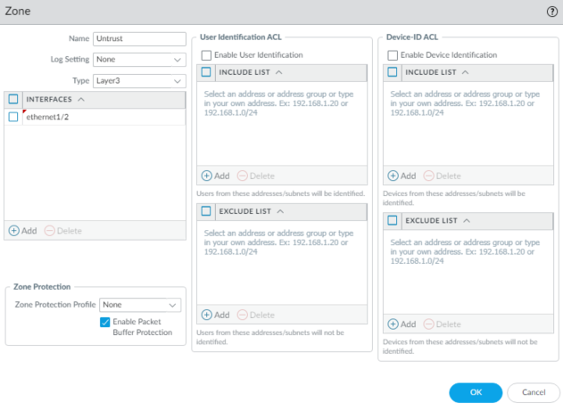
## Cấu hình default route
Sau khi tạo zones xong cần tạo route để cho LAN ra Internet, vào Network => Virtual Router => default (lab nên dùng mặc định của FW).
Cấu hình route trong mục Static Route như sau:
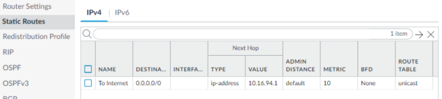
## Tạo các address object tương ứng
Tạo tiếp hai Object là 2 địa chỉ WAN và LAN, Object => Addresses => Add
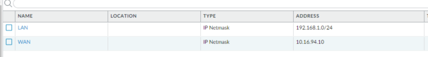
## Cấu hình NAT
Tiếp theo tạo NAT overload (Policy => NAT => Add)
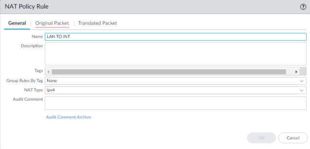
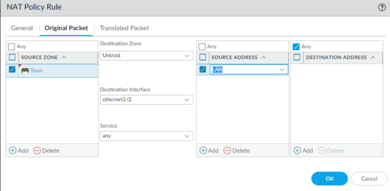
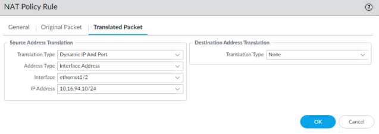
## Khởi tạo rule PAN
Cuối cùng là viết Policy cho LAN truy cập Internet (Policy => Security => Add)
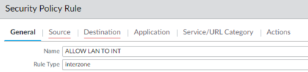
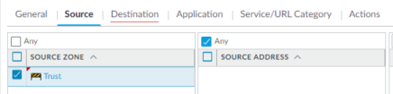
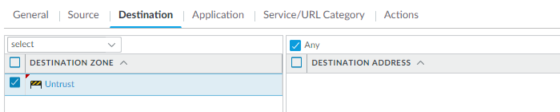
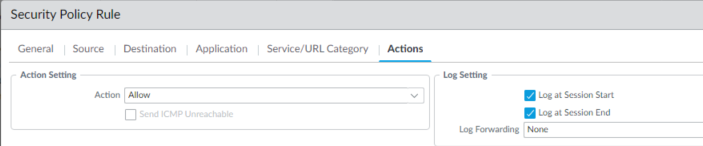

Sau đó bấm commit để thực thi cấu hình
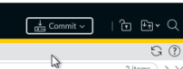
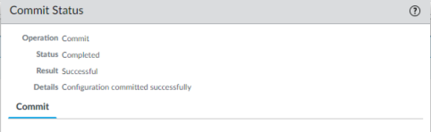
## Kiểm tra cấu hình
Test ping từ máy tính trong LAN
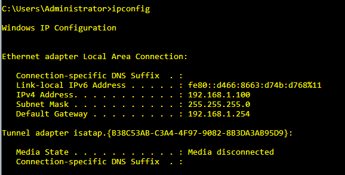
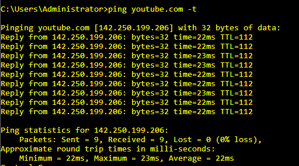